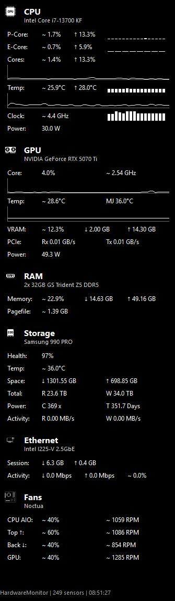

# Sidebar Metrics (Hardware Monitor)

For more sensors to be detected, install PawnIO (if you have the latest version of FanControl by Rem0o it is already installed).
> Do not use the WinRing0 as it has a CVE-2020-14979 (CVSS=7.8)

My personal setup for the sidebar is shown below as an example:

